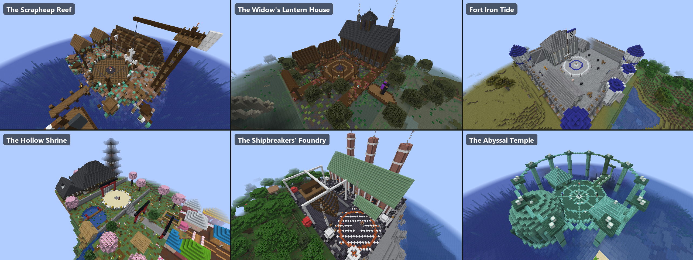
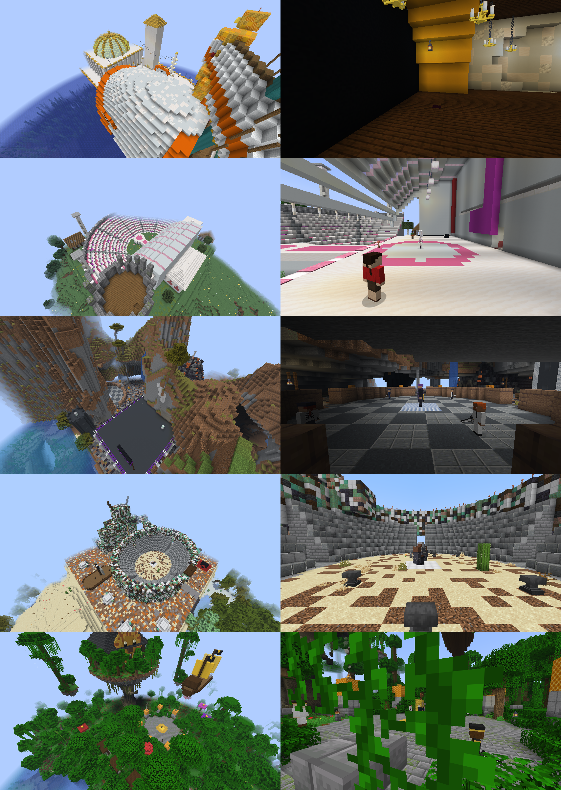

# One Piece Bosses

A companion mod for the One Piece Mod that adds original rogue boss fights, plus the villains of the One Piece films (who aren't in the main mod's story), so there's always someone new to fight. Each boss brings their own crew, their own lines, a phase 3 signature move and a lair out in the world.

Requires the One Piece Mod (Fabric, Minecraft 26.3, Java 25).

## The rogues

| Rogue | Tier | Fights with | Crew | Phase 3 signature | Trophy |
| --- | --- | --- | --- | --- | --- |
| **"Saltjaw" Gully Rourke**, a salvage pirate who drags his ship's anchor on a chain | 1 | Punches, then ground quakes | Scrapdeck Raiders | **Anchor Drag**: hauls you in along the chain into a flying cut | Rusted Anchor Link |
| **Corvina, the Fog Widow**, queen of a smuggling ring that only sails in fog | 2 | Smoke, then vanishing strikes | Lantern Smugglers | **Widow's Veil**: blinds everyone nearby, reappears behind you, smoke rains down | Widow's Lantern |
| **Commodore Hollis "Iron Tide" Graves**, a Navy deserter selling "protection" | 3 | Sword sweeps, then Haki | Deserter Marines | **Seastone Volley**: metal rains down and drains Devil Fruit users | Deserter's Epaulette |
| **Tsurugi, the Hollow Ronin**, an empty suit of samurai armor that still duels | 3 | Sword, then curses | none (duels alone) | **Hollow Cut**: a flying cut, and the armor's curse withers anyone close | Hollow Menpo |
| **Boilerheart Gantz**, a shipbreaker built around a ship's boiler | 4 | Fire, then quakes | Boiler Stokers | **Boiler Burst**: a scalding wave all around, then he slows down to cool (hit him then) | Cracked Boiler Core |
| **Nereus Vane, Herald of the Deep**, a fishman prophet of something far below | 5 | Pulls, then quakes | Abyssal Cultists | **Tidal Judgment**: a whirlpool drags everything in while freezing water rains down | Abyssal Conch |

## The film villains

The main antagonists of the One Piece films, built the same way as the rogues (their own bodies, crews, lines, signatures, trophies, posters and lairs). They're the toughest fights in the mod.

| Villain | Film | Tier | Fights with | Crew | Phase 3 signature | Trophy |
| --- | --- | --- | --- | --- | --- | --- |
| **Gild Tesoro**, owner of the casino-ship Gran Tesoro (Gold-Gold Fruit) | Film Gold | 4 | Gold that holds you still, then pulls | Gran Tesoro Security | **Golden Finale**: the gold you touched grabs you (heavy slowness and mining fatigue), molten gold rains down | Tesoro's Golden Chip |
| **Uta**, the world's diva (Sing-Sing Fruit) | Film Red | 5 | Staff-line bindings, then teleports | her entranced fans | **Uta World**: her song puts everyone half to sleep (nausea, slowness), then Tot Musica's light falls | Diva's Headphones |
| **"Z", Admiral Zephyr** of the Neo Marines | Film Z | 5 | Punches, then Haki | Neo Marines | **Battle Smasher**: a seastone haymaker that sends you flying and drains fruit users, a shockwave and Smash Blaster shells | Battle Smasher Knuckle |
| **Douglas Bullet**, the Demon Heir (Clank-Clank Fruit) | Stampede | 5 | Punches, then Haki | none (fights alone) | **Gashapon Fortress**: fuses scrap into armour (resistance and absorption), scrap rains down, then a shockwave | Clank-Clank Rivet |
| **Shiki, the Golden Lion** (Float-Float Fruit) | Strong World | 5 | Launches you into the sky, then his sword legs | Golden Lion Pirates and his mutated beasts (manticores, humandrills, basilisks) | **Lion Float**: floats everyone into the air and lets go, while floating rock rains down | Golden Lion's Helm, and his **Float-Float Fruit** |
| **El Drago** (Goe Goe Fruit) | One Piece: The Movie | 3 | Shockwave roars, then punches | El Drago Pirates | **Goe Goe Blast**: a voice beam down a line that leaves you dizzy and thrown back, with a sonic boom | El Drago's Golden Nail |
| **Gasparde**, ex-Marine captain (Ame Ame Fruit) | Dead End Adventure | 4 | Syrup that sets you solid, then his sword | Gasparde Pirates | **Syrup Flood**: a wave of syrup that bogs you down (heavy slowness, mining fatigue), then hardened spikes rain down | Hardened Syrup Spike |
| **Baron Omatsuri**, lord of Omatsuri Island | Baron Omatsuri and the Secret Island | 4 | Roots and curses, and a bow | the revived Red Arrows Pirates | **Lily Arrow Storm**: Lily Carnation drains you (wither) to heal him while flower arrows rain down | Red Arrow of Omatsuri |
| **Dr. Ratchet**, the Karakuri lord | The Giant Mechanical Soldier of Karakuri Castle | 4 | Pulls you in, then shockwaves | Karakuri soldiers | **Super Zogame-kun**: his giant turtle mech hauls you in, cuts a line and shells the area | Karakuri Clockwork Gear |
| **Byrnndi World** (Moa Moa Fruit) | 3D2Y | 5 | Blinks at you, then Haki | World Pirates | **Moa Moa Hundred**: goes a hundred times faster, rains boulders thrown at a hundred times the speed, then a shockwave | World's Broken Horn |

Bounties for a first win: Tesoro 300M, Uta 400M, Zephyr 500M, Bullet 800M, Shiki 900M, El Drago 90M, Gasparde 200M, Ratchet 220M, Omatsuri 250M, World 700M.

Their looks: Bullet is a gorilla of a man with arms thicker than his body in fused-scrap gauntlets and a riveted plate on his back; Tesoro is all legs under a green pompadour, red shades, a white suit and a gold fur stole and cape, with hands of gold rings; Zephyr is lopsided by the Battle Smasher, a seastone war-arm bigger than his chest, under purple hair and a Neo Marine coat; Shiki has a golden mane bigger than he is, a ship's wheel stuck in his skull and two swords where his legs should be; Uta has red-and-white hair looped into two great rings, headphones and a frilled skirt; El Drago has a red lion's mane, a white shirt under gold shoulder armour and gold nails; Gasparde is tall and broad in an ornate Marine coat with the gull crossed out, a purple scarf and steel boots; Omatsuri is long and lean with a triangle head, palm-tree hair, pink goggles, a flowered purple suit and Lily Carnation on his shoulder; Ratchet is a lanky boy in yellow overalls, round orange goggles and a black scarf of red gears; World is huge up top on thin green legs, with a green beard, a W moustache and a horned helmet missing a horn.

## Their looks

Each rogue has their own body, with wild One Piece proportions instead of the player shape: Rourke is all barrel chest and ground-scraping forearms on tiny legs with his anchor on his back, Corvina is a stilt-legged shadow under a table-wide hat trailing a fog-grey train, Graves is a V-shaped slab with a ship's-prow chin and a torn Justice coat, Tsurugi is floating samurai armour with nothing inside, Gantz is a riveted boiler with a firebox belly, smokestacks and piston arms, and Nereus is a long-armed fishman with a dorsal fin, fin ears and a shark's jaw. They still walk, swing and look around like any mob, and coats, trains and skirts swing as they move. Each one's hitbox is sized to their body (`hitbox` in `bosses.json`).

The models and their skins come from `tools/gen_models.py` (needs Pillow): change a box or colour there and run `python3 tools/gen_models.py .`. It writes `client/RogueModels.java` and the 128x128 skins together, so they always match.

## How the fights work

- **Underneath they're the One Piece Mod's own bosses**, so everything its story bosses do, rogues do too: the health bar, phases at 66% and 33%, warning circles before attacks, Expert rage, healing when you run, Berries and XP, and Hard and Expert rematches with better prizes. Their special attacks are the main mod's boss powers.
- **Their crew** arrives when the fight starts and again at phase 2 (more on Hard and Expert), and scatters when the boss falls. Crews are the main mod's pirate NPCs, so they use its fighting styles and skins. `/npc spawn scrapdeck_raider` and friends work too.
- **Their lines**: each rogue has something to say when the fight starts, at each phase and when beaten.
- **Bounty**: a first win raises your bounty by the rogue's own amount (12M for Rourke up to 600M for Nereus Vane). Rematches add 10% of the tier value, like any boss. The paper reports first wins, and Arsenal's meito count rogues as named bosses.
- **Trophy**: each rogue drops their trophy the first time someone nearby beats them at that difficulty.
- **Lair key**: each rogue drops the key to their lair's chest every time they're beaten ("Key to The Gran Tesoro" and so on). The chest is locked: hold the key in your main hand to open it. Without it the chest won't open or break, except in creative.
- **Lair Restoration Charter**: craft one (gold ingots around a diamond, paper and a compass: `GDG / PCP / GPG`) and use it inside a lair once its boss is beaten. The whole lair is rebuilt where it stands: every block, the boss and crew, and a fresh locked chest with new loot. It's used up. It also works on the One Piece Mod's boss structures whose boss lives in the structure (Buggy's Big Top, Loguetown, Rain Dinners, Shandora, Dressrosa Palace, Onigashima, Whole Cake Chateau and the rest listed in `opbosses/rebuildable.json`, from `tools/gen_rebuildable.py`).

## Finding them

- **Rumor Posters** are the rogues' Wanted Posters. Use one on a block to call the rogue out. Beat them and the poster brings them back on Hard, then Expert; sneak while using it for a Normal fight.
- The main mod's pirates and Marines sometimes carry a Rumor Poster when beaten (4% for a tier 1 rogue down to 0.6% for tier 5). Which NPCs know about which rogue is `rumorFrom` in `bosses.json`.
- Creative: the **One Piece: Rogue Bosses** tab has every poster, trophy, key and lair chest (a chest you place yourself is plain storage, with no lock).

## Changing or adding a rogue

| File | What it does |
| --- | --- |
| `src/main/resources/opbosses/bosses.json` | **Every rogue: stats, powers, prizes, bounty, crew, lines, signature, rumors and trophy.** Same format as the main mod's `characters.json`, plus this mod's fields. |
| `src/main/resources/opbosses/crews.json` | **The crews.** Same format as the main mod's `npc_kits.json`. |
| `src/main/java/com/onepiecebosses/boss/RogueSignatures.java` | The phase 3 signature moves. A boss can also use any of the main mod's (`slash_line`, `black_hole`, `rain_fire`...). |
| `src/main/java/com/onepiecebosses/boss/RogueBossEntity.java` | The boss mob: the main mod's boss with our data, plus crew, lines and signature. |
| `src/main/java/com/onepiecebosses/compat/OnePieceBridge.java` | Every other call into the main mod. If it renames something, fix it here. |
| `tools/gen_models.py` | **Each rogue's body shape and skin.** Writes `client/RogueModels.java` and the skins. |
| `tools/gen_chests.py` | **Each lair's own chest:** the model, textures and name. Run `python3 tools/gen_chests.py src/main/resources` after a change (then `gen_assets.py` for the names). |
| `tools/gen_assets.py` | Draws the poster, trophy and key art and writes the item JSON. |
| `tools/lairs/gen_lairs.py` | **Each rogue's lair:** the build, where it spawns, and its chest loot. Run `python3 tools/lairs/gen_lairs.py .` after a change. |
| `tools/lairs/film_lairs.py` | The film villains' lairs and their chest loot (gen_lairs.py builds them too). |

To add a rogue: add an entry to `bosses.json` (and a crew to `crews.json` if it has one), give it a body in `ROGUES` in `tools/gen_models.py` and its trophy a look in `TROPHIES` in `tools/gen_assets.py`, then run both (`python3 tools/gen_models.py .` and `python3 tools/gen_assets.py src/main/resources`, needs Pillow).

## Their lairs

Every rogue has a base of their own out in the world, so you can stumble on them without a poster. Each one spawns its boss and crew once, when it's first generated, and has a chest of its own design (Tesoro's gold vault with a roulette lock, Uta's music box, a giant clam, a lion-faced chest for Shiki...), locked to the key that boss drops, whose loot always includes that boss's Rumor Poster for a rematch. They're rare: about one rogue lair per 44 chunks, and separately one film lair per 40 chunks. Find one with `/locate structure opbosses:<name>`.

| Lair | Rogue | Where |
| --- | --- | --- |
| `scrapheap_reef`: a scrap island with beached wrecks and a salvage crane | Saltjaw Rourke | Oceans and beaches |
| `lantern_house`: a stilt manor ringed with lanterns | Corvina | Swamps, Thriller Bark |
| `fort_iron_tide`: a deserted Navy fort under his own flag | Iron Tide Graves | Plains, savanna, beaches, East Blue, Jaya |
| `hollow_shrine`: a dueling ring under a torii, ringed with beaten swordsmen's blades | Hollow Ronin Tsurugi | Cherry groves, meadows, hills, taiga, Wano |
| `shipbreakers_foundry`: a furnace hall by a warship being torn apart | Boilerheart Gantz | Stony shores, badlands, desert, Onigashima, Punk Hazard |
| `abyssal_temple`: a prismarine arena rising out of the sea | Nereus Vane | Oceans |
| `gran_tesoro`: a gold casino-ship 100 blocks long: a domed casino with roulette tables, slot machines and a gallery, the gold vault in the hull (the chest), a hotel tower, and a 45-block gold statue of Tesoro on the bow | Gild Tesoro | Oceans, New World sea |
| `elegia_stage`: a concert stage under a great shell, speaker stacks, a runway into an amphitheatre for hundreds, Uta's dressing room (the chest), and ruined Elegia's broken castle tower | Uta | Meadows, flower forests, plains, Dressrosa |
| `end_point`: a volcano with a glowing crater and a Dyna Stone vault inside, the Neo Marine HQ (Zephyr's office and the chest on the top floor), a training ground, a battleship in dry dock, watchtowers and cannons | Zephyr | Badlands, savanna plateaus, stony shores, Punk Hazard, Marineford |
| `ironclad_colosseum`: an oval colosseum of fused scrap with an arena floor, and Bullet's Gashapon war machine slumped against its wall; his camp (the chest), wrecked ships and scrap heaps outside | Douglas Bullet | Desert, savanna, plains, Alabasta |
| `merveille`: a jungle court ringed with lions, cages of mutated beasts, a rock spire with a stair to a floating island where Shiki's palace has a lion's head for a gate (the chest), more floating islets and his flagship hanging in the sky | Shiki | Jungles, Little Garden |
| `gold_island`: a gold-veined mountain with a switchback stair to Woonan's hut on the summit (the chest), Woonan's castle blasted full of round holes with its courtyard for an arena, gold dig pits and a mine-cart line, and El Drago's gold-plated ship with a lion figurehead run up on the beach | El Drago | Beaches, stony shores, jungles |
| `salamander`: an ironclad steam racer nearly 100 blocks long with paddle wheels and three smoking funnels, a chequered racing foredeck, a two-deck bridge with Gasparde's cabin (the chest), a betting lounge in the hull, and the Dead End's finish-line lighthouse off the bow | Gasparde | Oceans |
| `omatsuri_island`: a festival island with the Trials of Hell ring under strings of paper lanterns, a judge's tower, goldfish scooping, ring toss and a shooting gallery, a guest hotel, and Lily Carnation grown huge on a hill with roots writhing out of it, Omatsuri's shrine at its foot (the chest) and the Red Arrows' empty graves | Baron Omatsuri | Beaches, sparse and bamboo jungles, savanna, cherry groves |
| `karakuri_castle`: Mecha Island, a giant sea turtle with a scute-plated shell, red-eyed head and flippers, carrying Karakuri Castle (a machine hall, barracks, a throne room and Ratchet's workshop on top with the chest), a clock tower, shell cannon turrets and the Tetsujin-kun mech standing over a cog-floored courtyard | Dr. Ratchet | Oceans and deep oceans |
| `groseade`: World's black-and-purple warship hauled up on a slipway with its island-sinking bow cannon raised (his stern cabin has the chest), a scorched crater arena with thrown boulders, the World Pirates' camp and dump of giant shells, a Marine fort he punched through, and a scrap lookout | Byrnndi World | Stony shores, beaches, plains, snowy plains |

## Building

The One Piece Mod isn't on a maven, so build against its jar, the same way as One Piece Arsenal:

1. In the One Piece Mod, run `./gradlew build`.
2. Copy `build/libs/onepiece-0.1.0.jar` into this repo's `libs/` folder (change `onepiece_jar` in `gradle.properties` if the name differs).
3. Run `./gradlew build` here. The jar lands in `build/libs/`; put it in your `mods/` folder next to the One Piece Mod.
4. To test, run `./gradlew runClientGameTest`. A game window opens, fights every boss in a test world and closes: Rumor Poster spawn, crew waves, phase lines, signature moves, trophy, bounty (including a long-range kill), the Hard rematch and Rumor Poster drops. It fails with a list of what went wrong, and saves screenshots to `build/run/clientGameTest/screenshots`. The tests are in `src/gametest` and never go into the mod jar, and a normal `runClient` or modpack launch never runs them. To replay only what a change touches, add `-Dopbosses.tests=bosses` or `lairs` (or `models` for model portraits) and `-Dopbosses.only=<boss ids or lair names>`.

## Planned

- Their own Devil Fruits (needs a small hook in the main mod, which only registers fruits from its own list).
- Rogue-only prizes that work with Arsenal (a Boiler Core as a material, the Hollow Ronin's blade as a meito).
